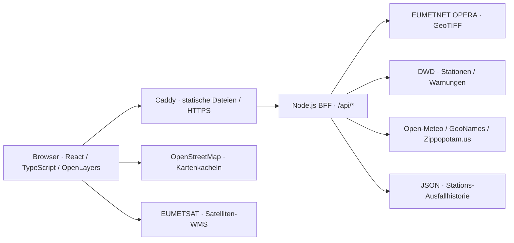

# Wetterkarte Europa

**Interaktive Wetterdaten auf einer gemeinsamen Karte – von europäischen Radar-Rohdaten bis zur lokalen Vorhersage.**

Eine Full-Stack-Webanwendung mit React, TypeScript und OpenLayers sowie einem schlanken Node.js-Backend. Sie verbindet Niederschlagsradar, Satellitenbilder, Stationsmessungen und amtliche DWD-Warnungen mit einer steuerbaren Zeitleiste.

Der technische Schwerpunkt liegt nicht nur auf der Visualisierung: Die Anwendung verarbeitet GeoTIFF-Radardaten zu PNGs, koordiniert asynchrone Bildabrufe und führt Warngeometrien zusammen, ohne deren ursprüngliche lokale Informationen zu verlieren.

**Erste Veröffentlichung:** Anwendungscode unter **AGPL-3.0-or-later**, mit Docker Compose und Caddy selbst betreibbar. Die Bereitstellung ist für `smartcontentstudio.de` vorgesehen; ein erfolgreicher Livebetrieb wird hier erst nach dem tatsächlichen Start bestätigt.

[Einblicke](#einblicke) · [Funktionen](#funktionen) · [Architektur](#architektur) · [Lokal starten](#lokal-starten) · [Tests](#tests-und-qualitätsprüfung) · [Deployment](#deployment) · [Lizenzen](#datenquellen-und-lizenzen)

## Einblicke


*Vom europäischen Wettergeschehen zur lokalen Messung: Radar, deutsche Stationswerte und eine geöffnete Vorhersage im selben Kartenkontext.*

<sub>Karte: © [OpenStreetMap contributors](https://www.openstreetmap.org/copyright), ODbL. Radar: [EUMETNET OPERA](https://eumetnet.github.io/openradardata-documentation/1-ORD-API-overview/), [CC BY 4.0](https://creativecommons.org/licenses/by/4.0/), farblich aufbereitet und reprojiziert. Stationswerte/Warnflächen: DWD. Vorhersage: [Open-Meteo](https://open-meteo.com/), DWD ICON, CC BY 4.0, als Diagramm aufbereitet.</sub>

### Radar und Satellit im zeitlichen Vergleich


*Gemeinsame verfügbare Zeitpunkte statt eines Vergleichs unterschiedlich alter Bilder.*

<sub>Karte: © [OpenStreetMap contributors](https://www.openstreetmap.org/copyright), ODbL. Radar: [EUMETNET OPERA](https://eumetnet.github.io/openradardata-documentation/1-ORD-API-overview/), [CC BY 4.0](https://creativecommons.org/licenses/by/4.0/), farblich aufbereitet und reprojiziert. Satellit: [EUMETSAT Meteosat / EUMETView](https://view.eumetsat.int/), msg_fes:ir108, Datenstand 2026, [CC BY 4.0](https://creativecommons.org/licenses/by/4.0/); Kontrast/Helligkeit und Überblendung angepasst. Stationswerte/Warnflächen: DWD.</sub>

### Warngebiete mit lokalem Kontext


*Zusammengeführte Warnflächen für den Überblick, ursprüngliche lokale Warntexte für die Details.*

<sub>Karte: © [OpenStreetMap contributors](https://www.openstreetmap.org/copyright), ODbL. Warnungen und Stationswerte: Deutscher Wetterdienst; Warnflächen für die Darstellung zusammengeführt und schraffiert.</sub>

Die Aufnahmen vom **9. November 2026** zeigen den damaligen Datenstand, keine
aktuelle Wetterlage. Die Quellenhinweise gelten jeweils für die dargestellten
Daten. Die bestätigte EUMETSAT-Datenlizenz und davon getrennte offene
Dienstbedingungen sind unter [Datenquellen und Lizenzen](#datenquellen-und-lizenzen) beschrieben.

## Funktionen

| Bereich | Umsetzung |
| --- | --- |
| **Europa-Radar** | EUMETNET OPERA RATE-Komposit mit 2-km-Raster, Farbskala in mm/h, verfügbaren 15-Minuten-Zeitpunkten und bis zu 13 Bildern aus den letzten vier Stunden. |
| **Satellit** | EUMETSAT-Meteosat-Infrarotbilder mit Zeitleiste und einstellbarer Deckkraft. |
| **Gemeinsame Wiedergabe** | Radar und Satellit anhand tatsächlich gemeinsamer Zeitpunkte abspielen; die nächste Wiedergabestufe wartet auf beide Bilder. |
| **Stationsnetz** | 100 ausgewählte deutsche DWD-Stationen mit Temperatur, Luftfeuchte und Wind; Cluster mit Durchschnittstemperatur und Zoom zu Einzelstationen. |
| **Wetterwarnungen** | Eigene Darstellung auf Basis von DWD-Warnungen mit Schraffur, Schweregrad und Beschriftung; Originaltexte, Gültigkeit und lokale Zuordnung per Klick. Kein amtlicher Warnkanal. Die Warnabdeckung ist Deutschland, nicht ganz Europa. |
| **Ortssuche** | Europäische Länderauswahl mit Deutschland als Vorauswahl, Ortsnamen sowie deutsche Postleitzahlen. Treffer zeigen Region und Land. |
| **Punktvorhersage** | 24-Stunden-Verlauf und Sieben-Tage-Ausblick für Suchtreffer, Stationen oder Kartenklicks über Open-Meteo/DWD ICON, mit lokaler Zeitzone. Verfügbarkeit abhängig vom Datenanbieter. |
| **Bedienung** | Deutsche und englische Oberfläche, eigene Mobile-Shell bis einschließlich 700 px mit Vollbild-Panels, schwebender Suche und gemeinsamem Timeline-Dock; optional gespeicherte Karteneinstellungen. |
| **Transparenz** | Sichtbare Kartenattribution, Quellen-/Lizenzübersicht, Wetterhinweise und ausdrücklich gekennzeichnete Entwürfe für Impressum und Datenschutz. |

Die geografische Abdeckung unterscheidet sich je nach Quelle. Eine europaweite Ortssuche bedeutet weder flächendeckende Radarversorgung noch europaweite Stations- oder Warnungsdaten.

Radar, Satellit, Stationen und Warnungen sind standardmäßig eingeschaltet.
Mit Einwilligung gespeicherte Ebeneneinstellungen haben weiterhin Vorrang.
Auf dem Desktop scrollt die Seitenleiste bei einer Stations-, Kartenpunkt-,
Suchtreffer- oder Warnflächenauswahl automatisch zum Detailbereich und hebt
ihn kurz hervor. Die Karte selbst wird dadurch nicht verschoben.

### Mobile Bedienung

Bis einschließlich **700 px Fensterbreite** bleibt die Karte bildschirmfüllend,
auch im Querformat. Die Suchleiste öffnet die Ortssuche; rechts öffnen die
schwebenden Tasten Ebenen, den zuletzt gesteuerten Zeitlayer und das Menü.
Suche, Ebenen, Vorhersage, Warnungsdetails und Menü teilen sich ein
Vollbild-Panel mit Zurück-Pfeil. Zurück, Escape, der schmale abgedunkelte Rand
oberhalb des Panels oder eine Abwärts-Wischgeste am Kopf schließen es.
Der Tastaturfokus bleibt im geöffneten Panel.

Das untere Dock steuert Radar bzw. Satellit; bei zwei aktiven Ebenen wechselt
man über die beschrifteten Tasten zwischen den Zeitlisten. Das Schließen im
Dock deaktiviert nur die gesteuerte Ebene. Synchronisation bleibt über das
Ebenen-Panel und direkt über „Synchron“ im Dock verfügbar; dann steuern beide Dock-Tasten dieselben gemeinsamen
Zeitpunkte. Deckkraft und Quellenhinweise bleiben im Ebenen- bzw. Menü-Panel.
Panelwechsel unterbrechen weder Wiedergabe noch Vorladen oder Kartenzustand.
Radar- und Satellitenzeitlisten werden alle fünf Minuten geprüft
(Satellitenaufnahmen weiterhin in 15-Minuten-Abständen); die ausgewählte
verfügbare Bildzeit bleibt bei Aktualisierungen erhalten.

Der Warn-Chip zeigt die höchste **bereits gültige** Warnstufe im aktuellen
Kartenausschnitt, sofern Warnungen eingeschaltet und erfolgreich geladen sind.
Bevorstehende Warnungen bleiben auf der Karte sichtbar, zählen aber noch nicht
zum Chip. Ein fehlender Chip ist **keine Entwarnung**. Stations- und
Warnflächenklicks öffnen ihre Details; „Auf Karte zeigen“ führt zur Position.
Offene Panels und Dock-Auswahl werden nicht gespeichert. Oberhalb von 700 px
bleibt die bisherige Desktop-Bedienung erhalten.

Mobil sind die Kartenquellen ganz unten über das kleine Info-Symbol
aufklappbar. Das kompakte Dock liegt darüber und weicht den aufgeklappten
Quellen aus; auf dem Desktop bleiben die Quellen dauerhaft sichtbar.

### Eigener Standort (optional)

Die Zieltaste ermittelt erst nach Hinweisbestätigung und Browserberechtigung
einmalig den Standort (HTTPS oder localhost erforderlich). Ein blauer Punkt
markiert die ungefähre Position; keine laufende Ortung, Adressauflösung oder
automatische Wetterabfrage. „Standort ausblenden“ entfernt den Punkt.
Nach erfolgreicher Ortung bleibt die Speicherung des Kartenausschnitts für
den Rest dieses Besuchs ausgesetzt, einschließlich Speichern beim Verlassen;
vorher gespeicherte Ansichten bleiben erhalten. Position und Sperre werden
nicht persistiert. Karten-/Satellitenabrufe können den ungefähren Standort
indirekt offenlegen; der DE/EN-Hinweis und der Datenschutzentwurf erläutern
dies. Die Ergänzung ist keine rechtliche Freigabe.

### Zum Startbildschirm hinzufügen

Im mobilen Menü bietet „Als App hinzufügen“ den vom Browser bereitgestellten
Installationsdialog an. Ist dieser nicht verfügbar, erscheint eine Anleitung
für das Browsermenü bzw. Safari auf iPhone/iPad. Die Installation benötigt
immer eine Bestätigung durch den Nutzer und hängt von Browser und Plattform
ab; sie kann nicht automatisch erzwungen werden. Bereits im eigenständigen
App-Fenster erscheint stattdessen ein Statushinweis.

Manifest und eigene PNG-Symbole (180/192/512 px) werden durch
`scripts/app-assets.mjs` vor Entwicklungsstart und Produktionsbuild erzeugt,
auch im Docker-Build. Kein Service Worker, Offline-Cache, Push oder
Installations-Tracking wird hinzugefügt. Wetterdaten benötigen weiterhin eine
Internetverbindung; vorhandene Datenschutzbedingungen bleiben maßgeblich.

## Architektur



In der lokalen Entwicklung ersetzt der Vite-Devserver Caddy und leitet `/api` an das Backend weiter. Für den Serverbetrieb sind Frontend und API unter derselben Domain vorgesehen.

**Bewusste Begrenzung:** eine Backend-Instanz, prozesslokale Caches und keine Anwendungsdatenbank. Nur die Stations-Ausfallhistorie wird als JSON-Datei persistiert. Es gibt keine Benutzerkonten.

### Technische Entscheidungen

**Radar-Aufbereitung statt bloßer Bildweiterleitung.** Das Backend liest die OPERA-GeoTIFFs mit `geotiff`, ordnet Niederschlagsraten einer gemeinsamen Farbskala zu und erzeugt mit `pngjs` transparente PNGs. Projektionsinformationen werden an den Client übergeben; `proj4` und OpenLayers übernehmen die Karteneinpassung. Die Anzeige interpoliert Bilder, erhöht damit aber nicht die Messauflösung.

**Request-Coalescing und begrenzte Parallelität.** Gleichzeitige Abrufe desselben Radarzeitpunkts teilen ein gespeichertes Promise. Dadurch läuft die Aufbereitung dieses Bildes nicht mehrfach parallel. Maximal zwei Konvertierungen laufen gleichzeitig; fehlgeschlagene Einträge werden entfernt, damit erneute Versuche möglich bleiben. Das ist eine Ein-Prozess-Lösung, kein verteilter Cache oder allgemeiner Schutz vor Race Conditions.

**Zeitliche Konsistenz.** Die gemeinsame Wiedergabe verwendet die exakte Schnittmenge der Radar- und Satellitenzeitpunkte, keine ersatzweise „nahegelegenen“ Bilder. Langsame Abrufe bremsen die Wiedergabe; Ladefehler stoppen sie mit einer Meldung. Die Ebenen laden ihre Bilder separat – ein atomarer gemeinsamer Bildtausch wird nicht zugesichert. Bei einer automatischen Radaraktualisierung bleibt die Auswahl erhalten oder wechselt zum nächstgelegenen noch verfügbaren Zeitpunkt.

**Warnflächen ohne Gemeinde-Raster.** `polygon-clipping` vereinigt benachbarte Flächen nur bei übereinstimmenden inhaltlichen Warnmerkmalen. Löcher und getrennte Teilflächen bleiben erhalten. Die ursprünglichen Geometrien dienen weiterhin der Trefferprüfung, damit ein Klick den passenden lokalen Warntext liefert.

**Fehlende Werte bleiben fehlend.** Messlücken erscheinen als „–“ statt als Null und unterbrechen Diagrammlinien. Nicht verfügbare Stationen werden gesondert ausgewiesen. Eine persistente Historie dokumentiert Stationsausfälle und Wiederherstellungen bei tatsächlichen Datenaktualisierungen; sie ist kein kontinuierlicher Überwachungsdienst.

## Technologie

| Schicht | Bausteine |
| --- | --- |
| Frontend | React, TypeScript, Vite |
| Karte und Geometrie | OpenLayers, proj4, polygon-clipping |
| Backend | Node.js, native HTTP- und Fetch-APIs, ES-Module |
| Rasterverarbeitung | geotiff, pngjs |
| Automatisierte Tests | Node.js Test Runner, `node:assert` |
| Bereitstellung | Docker-Multistage-Build, Docker Compose, Caddy |

## Lokal starten

Voraussetzungen: **Node.js 24** mit npm, eine lokale Kopie dieses Repositorys und Internetzugang zu den Datenanbietern.

Im Projektverzeichnis einmalig die Abhängigkeiten installieren:

```sh
npm ci
```

Anschließend zwei Terminals im selben Verzeichnis öffnen:

```sh
# Terminal 1: Backend
npm run api
```

```sh
# Terminal 2: Frontend
npm run dev
```

Die Anwendung ist standardmäßig unter **http://localhost:5173** erreichbar, das Backend unter **http://localhost:8787**. Sollte Vite einen anderen Port wählen, gilt die ausgegebene Adresse.

Für den aktuellen Entwicklungsstand müssen keine API-Schlüssel eingetragen werden. Die öffentlichen Dienste unterliegen trotzdem Nutzungsbedingungen und Kontingenten; insbesondere ist der kostenlose Open-Meteo-API-Zugang nicht pauschal für kommerzielle Nutzung freigegeben.

Die Docker-Umgebungsdatei wird für diesen lokalen Start nicht benötigt. Eine abweichende Backend-Portbelegung erfordert auch eine Anpassung des Proxys in `vite.config.ts`.

### Befehle

| Befehl | Zweck |
| --- | --- |
| `npm run api` / `npm start` | Node.js-Backend starten. |
| `npm run dev` | Vite-Entwicklungsserver mit API-Proxy starten. |
| `npm test` | Automatisierte Tests ausführen. |
| `npm run build` | Lizenzhinweise und Quellcode-Download erzeugen, TypeScript prüfen und Frontend nach `dist` bauen. |
| `npm run source-release` | AGPL-Lizenztext und Quellcodearchiv für die ausgelieferte Version erzeugen; benötigt `tar`. |
| `npm run notices` | `public/third-party-notices.txt` aus den installierten Produktionsabhängigkeiten aktualisieren. |
| `npm run preview` | Gebautes Frontend lokal ansehen; kein vollständiger Produktionsstart und kein Ersatz für das API-Routing. |

## Tests und Qualitätsprüfung

```sh
npm test
npm run build
```

Die Tests decken unter anderem folgende Invarianten ab:

- Radarschwellen, Farben, transparente Fehlwerte und Projektionsreferenzen.
- Zeitpunkterhalt bei Radaraktualisierungen und exakte gemeinsame Wiedergabezeiten.
- Vereinigung von Warnflächen einschließlich Löchern, getrennter Gebiete und unveränderter Eingangsdaten.
- Filterung abgelaufener, stornierter und nicht öffentlicher Warnungen.
- Länderfilter, deutsche Postleitzahlen sowie Fehler- und Timeoutweitergabe der Ortssuche mit simulierten Upstream-Antworten.
- Persistenz von Stationsausfällen und Wiederherstellungen.
- API-Healthcheck, erlaubte HTTP-Methoden und globale Anfragebegrenzung.

Browserprüfungen für Desktop, Smartphone und Sprachwechsel wurden ergänzend mit Playwright durchgeführt. Eine reproduzierbare Playwright-End-to-End-Suite ist **noch nicht im Repository eingerichtet**. Die automatisierten Tests ersetzen keine Liveprüfung externer Wetterdienste.

## API-Überblick

| GET-Endpunkt | Inhalt |
| --- | --- |
| `/api/health` | Prozessstatus und Laufzeit; keine Aussage über die Erreichbarkeit aller Datenquellen. |
| `/api/radar/europe/times` | Verfügbare OPERA-Zeitpunkte und Farbskala. |
| `/api/radar/europe/frame/:timestamp.json` | Metadaten eines Radarbildes, einschließlich Ausdehnung und Projektion. |
| `/api/radar/europe/frame/:timestamp.png` | Aufbereitetes Radarbild; Zeitstempel in Unix-Millisekunden. |
| `/api/satellite/times` | Verfügbare EUMETSAT-Zeitpunkte. |
| `/api/stations` | Stationswerte, Datenstand und nicht verfügbare Stationen. |
| `/api/warnings` | Aufbereitete DWD-Warnungen mit ursprünglichen Flächen und Texten. |
| `/api/locations/search?q=Paris&country=FR&language=de` | Suche im gewählten Land; Standard `DE`, Sprache `de` oder `en`, zwei bis 100 Suchzeichen. |
| `/api/forecast?lat=48.8566&lon=2.3522` | Punktvorhersage mit automatisch ermittelter lokaler Zeitzone. |

Die gemeinsame Suchländerliste liegt in `src/data/searchCountries.json`. Bei transkontinentalen Staaten gilt die Auswahl für das gesamte Land; einzelne Gebiete können im Geocoding-Datenbestand keine Treffer liefern. Rein numerische Suchen außerhalb Deutschlands werden als nicht unterstützte Postleitzahlsuche abgewiesen.

Der ältere Endpunkt `/api/radar/times` bleibt für die derzeit deaktivierte DWD-Radar-Fallbackfunktion im Code. Die sichtbare Radaransicht verwendet OPERA.

## Projektstruktur

```text
src/
  App.tsx                    Kartenaufbau, Ebenen und gemeinsame Wiedergabe
  OperaRadar.tsx             OPERA-Darstellung, Bildladen und Steuerung
  WeatherWarnings.tsx        Warnflächen, Legende und lokale Details
  warningAreas.ts            Gruppierung und geometrische Vereinigung
  LocationSearch.tsx         Europäische Länderauswahl und Ortssuche
  StationForecast.tsx        Vorhersage und Diagramme
  synchronizedTimeline.ts    Gemeinsame Zeitpunkte
  radarTimeline.ts           Zeitpunkterhalt bei Aktualisierungen
  mapPreferences.ts          Validierte lokale Karteneinstellungen
  i18n.tsx                   Sprachumschaltung
  LegalPages.tsx             Quellen, Wetterhinweise und Rechtstext-Entwürfe
  legalConfig.ts             Öffentliche Betreiberangaben und offene Betriebsdetails
  satelliteAttribution.ts    EUMETView-Quelle, Lizenzlinks und metadatenbasiertes Datenjahr
server.mjs                   HTTP-API, Datenabrufe und prozesslokale Caches
opera.mjs                    GeoTIFF-zu-PNG-Pipeline und Request-Coalescing
warnings.mjs                 Abruf und Normalisierung der DWD-Warnungen
location-search.mjs          Länderbeschränkte Suche und deutsche PLZ
station-history.mjs          Persistente Stations-Ausfallhistorie
*.test.mjs                   Automatisierte Tests
scripts/third-party-notices.mjs
                             Sammlung der Software-Lizenzhinweise
scripts/source-release.mjs   Quellcodearchiv und AGPL-Lizenzdownload für den Build
LICENSE                      Vollständiger AGPL-v3-Lizenztext (Nutzung: Version 3 oder später)
deploy/                      Caddy-Konfiguration und Betriebsanleitung
Dockerfile / compose.yaml    Container-Build und Ein-Instanz-Betrieb
```

## Deployment

Die vorbereitete Serverarchitektur nutzt Caddy für statische Dateien, HTTPS und die Weiterleitung an das interne Backend. Nur die Webports werden veröffentlicht. Der API-Container läuft ohne Root-Rechte; Ressourcenlimits, Logrotation und persistente Volumes für Stationshistorie und Caddy-Daten sind konfiguriert.

**Ein API-Replikat betreiben:** Caches, Anfragegrenzen und die JSON-Historie sind nicht zwischen Instanzen koordiniert. Der globale Schutz von 32 gleichzeitigen Anfragen und 1.200 Anfragen pro Minute ersetzt weder nutzerbezogene Limits noch DDoS-Schutz.

Voraussetzungen, Domain-Konfiguration, Start, Updates und Sicherung sind in der **[Deployment-Anleitung](deploy/README.md)** beschrieben. Für öffentlichen Betrieb wird die Standarddatei `compose.yaml` verwendet; `compose.private.yaml` ist nur eine optionale Ergänzung für passwortgeschützte Tests. Nach dem Start HTTPS, Datenabrufe und Wiederherstellung auf dem Zielsystem prüfen.

## Datenquellen und Lizenzen

| Quelle | Verwendung und zu beachtende Bedingungen |
| --- | --- |
| [EUMETNET OPERA / NIMBUS](https://eumetnet.github.io/openradardata-documentation/1-ORD-API-overview/) | Radar-Komposit, CC BY 4.0; Quellen-, Lizenz- und Bearbeitungshinweise in der Anwendung. |
| [Deutscher Wetterdienst](https://www.dwd.de/DE/service/rechtliche_hinweise/rechtliche_hinweise.html) | Beobachtungen und Warnungen; produktbezogene Vorgaben abschließend prüfen. |
| [EUMETSAT / EUMETView](https://view.eumetsat.int/) | Meteosat-Infrarot, Layer `msg_fes:ir108`, WMS `https://view.eumetsat.int/geoserver/ows`; [CC BY 4.0](https://creativecommons.org/licenses/by/4.0/). Datenlizenz durch EUMETSAT Legal Affairs am 11.11.2026 bestätigt; technische Dienstbedingungen getrennt prüfen. |
| [Open-Meteo](https://open-meteo.com/en/terms) | Vorhersage und Geocoding. Daten unter CC BY 4.0; kostenlose API nur für nichtkommerzielle Nutzung. Eine beruflich werbliche Portfolio-Nutzung ist nicht automatisch als nichtkommerziell anzunehmen. |
| [GeoNames](https://www.geonames.org/export/) | Ortsdaten über Open-Meteo; Attribution beachten. |
| [Zippopotam.us](https://docs.zippopotam.us/docs/getting-started/) | Deutsche Postleitzahlen auf Basis von GeoNames; genaue Dienstbedingungen noch abschließend prüfen. |
| [OpenStreetMap](https://www.openstreetmap.org/copyright) | Kartendaten unter ODbL; zusätzlich gilt die [Nutzungsrichtlinie des Kachelservers](https://operations.osmfoundation.org/policies/tiles/). |

Die **[Software-Lizenzhinweise](public/third-party-notices.txt)** werden beim Build aus den installierten Produktionsabhängigkeiten erzeugt. Sie ersetzen keine Prüfung der Wetter- und Geodatenlizenzen.

**EUMETSAT-Bestätigung:** EUMETSAT Legal Affairs hat am 11.11.2026 bestätigt,
dass über EUMETView verfügbare Daten einschließlich `msg_fes:ir108` unter
CC BY 4.0 genutzt werden können. Frontend-Bildabruf und Backend-Zeitmetadaten
verwenden genau diesen Layer; die Abrufe wurden nicht geändert. Die Angaben
für Kartenattribution und Quellen-Seite stehen zentral in
`src/satelliteAttribution.ts`. Das Datenjahr wird aus dem UTC-Zeitstempel des
tatsächlich geladenen Bildes abgeleitet, nicht aus dem Kalenderjahr.
Ohne geladenes Bild nennt die Quellen-Seite das Jahr ausdrücklich als nicht
bestimmt. Das Screenshot-Datenjahr oben bezieht sich auf den dokumentierten
Aufnahmestand, nicht auf das heutige Datum.

Eigene Darstellungsänderungen: CSS-Kontrast 1,9, Helligkeit 1,25 und einstellbare
Deckkraft zur Überblendung im Screen-Mischmodus. Die meteorologischen Werte werden nicht neu
berechnet. WMS-PNG8 und reduzierte Bildauflösung sind technische
Darstellungsschritte. Die Bestätigung ist keine pauschale Website-Freigabe,
keine Empfehlung oder Partnerschaft und keine Zusage unbegrenzter Zugriffe.
Technische Dienstbedingungen, Limits, Caching-/Proxy-Vorgaben und Datenschutz
direkter Browserverbindungen bleiben getrennt zu prüfen. Andere Quellen
werden dadurch nicht freigegeben; die eigene Code-Lizenz bleibt unverändert.

**Eigener Anwendungscode:** Copyright (C) 2026 Heinz Danner. Lizenz:
[GNU Affero General Public License, Version 3 oder später](LICENSE)
(`AGPL-3.0-or-later`). Es besteht keine Gewährleistung im Umfang der Lizenz.
Wetter-/Kartendaten, Fremdinhalte in Screenshots und Drittanbieter-Software
behalten ihre gesonderten Bedingungen; die AGPL erteilt keine zusätzlichen
Rechte an diesen Inhalten.

Unter „Quellen & Lizenzen“ bietet die Anwendung den Lizenztext und ein
Quellcodearchiv der gebauten Version an. `npm run build` erzeugt diese Dateien
automatisch; der Docker-Build nimmt auch Backend, Buildskripte und
Bereitstellungskonfiguration auf. `.env`, private Schlüssel, lokale
Stationshistorie und `node_modules` gehören nicht in das Archiv.
Bei Änderungen oder Weiterbetrieb sind die AGPL-Pflichten zu beachten,
insbesondere das Angebot des entsprechenden Quellcodes bei modifizierten,
über ein Netzwerk genutzten Versionen. Das Angebot muss für Besucher
tatsächlich erreichbar sein; ein privates GitHub-Repository allein genügt
dafür nicht.

## Datenschutz und Grenzen

Kartenkacheln werden direkt vom Browser bei OpenStreetMap geladen, Satellitenbilder bei aktiviertem Layer direkt bei EUMETSAT. Ortssuche und Vorhersage laufen über das Backend; Suchtexte beziehungsweise Koordinaten werden dabei an die jeweiligen Anbieter übermittelt. Ein Backend-Proxy macht diese Informationen nicht automatisch anonym.

Sprache, Kartenausschnitt und Ebeneneinstellungen werden nur nach Zustimmung im `localStorage` gespeichert und gelesen. Die Entscheidung wird lokal mit Zeitpunkt und Textversion gespeichert; sie lässt sich im Seitenfuß jederzeit ändern oder widerrufen, wobei gespeicherte Einstellungen gelöscht werden. Ohne Zustimmung bleiben Änderungen nur während des Besuchs erhalten. Die lokale Entscheidung ist kein unabhängiger serverseitiger Einwilligungsnachweis. Die Einwilligung betrifft nicht direkte Drittanbieterabrufe. Es sind keine Analyse-/Werbesoftware und keine Benutzerkonten eingebunden; die rechtliche Bewertung steht aus.

Impressum und Datenschutz sind über die Anwendung erreichbar, aber **ausdrücklich Entwürfe**. Betreiberangaben in `src/legalConfig.ts` sind öffentlich ausgelieferte Inhalte – dort gehören keine Zugangsdaten oder privaten Steuernummern hinein.

Diese Karte ist **kein amtlicher Warnkanal oder Notfalldienst**. Daten können verspätet, unvollständig oder nicht verfügbar sein. Für sicherheitsrelevante Entscheidungen sind die amtlichen Originalwarnungen maßgeblich. Satelliten-Infrarot zeigt keine Regenintensität; transparente Radarbereiche garantieren keine Niederschlagsfreiheit.

Sind beim OPERA-Anbieter keine Radarbilder innerhalb des Vier-Stunden-Fensters
verfügbar, zeigt die App einen eigenen Verfügbarkeitshinweis und prüft
automatisch erneut. Veraltete Bilder werden nicht als aktuelle Daten
ausgegeben; Netzwerk- und Bildladefehler bleiben davon getrennt.

## Betriebshinweise

Die App ist ein ergänzendes Informationsangebot ohne Verfügbarkeitszusage.
Providerbedingungen, Kontingente und Datenschutz sind beim eigenen Betrieb
zu berücksichtigen. Konkrete Betriebsprüfungen und noch ungeklärte Angaben
werden in der [Deployment-Anleitung](deploy/README.md) geführt, nicht als
erledigt vorausgesetzt.

Die [DWD-Regeln für Quellenvermerke](https://www.wettergefahren.de/vorlagen_quellenangabe.html)
sind für die bearbeitete Warnungsdarstellung ohne abschließende rechtliche
Freigabe umgesetzt: kein unmittelbarer Quellenvermerk, stattdessen sichtbarer
Hinweis auf fehlende Vollständigkeits-/Aktualitätsgarantie und Link zu offiziellen
Warnungen. Datenbasis und Bearbeitung sind zentral dokumentiert;
Stations-Quellenvermerke bleiben unverändert.

---

**English summary:** An interactive European weather map built with React, TypeScript, OpenLayers and a native Node.js backend. Engineering highlights include GeoTIFF-to-PNG radar processing, in-flight request coalescing, timestamp-based radar/satellite playback, polygon union with preserved local warning details, country-filtered location search and point forecasts. Local setup: Node.js 24, `npm ci`, then `npm run api` and `npm run dev` in separate terminals. Application code is licensed under AGPL-3.0-or-later; data and dependencies retain their separate terms. The build provides a source archive and licence download. Self-hosting instructions are included; live deployment has not yet been verified.
